<p align="center">
  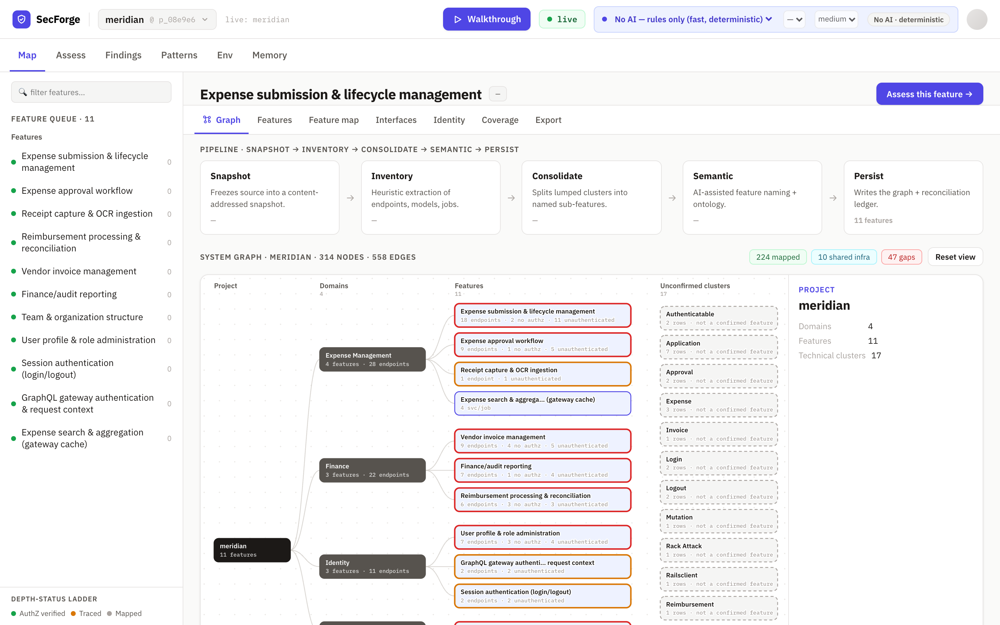
</p>

<h1 align="center">SecForge</h1>
<p align="center"><strong>Map once, hunt anywhere.</strong><br>
A self-contained white-box security workbench: it maps any codebase into a cited knowledge graph of features, entry points, roles and permissions, then runs tracked, feature-by-feature security assessments on top of that map.</p>

<p align="center">
  <a href="#quick-start">Quick start</a> ·
  <a href="#how-it-works">How it works</a> ·
  <a href="#the-workbench-tab-by-tab">Workbench tour</a> ·
  <a href="#ai-engines">AI engines</a> ·
  <a href="#data-layout">Data layout</a> ·
  <a href="#http-api">API</a> ·
  <a href="#security-model">Security model</a> ·
  <a href="#license">License</a>
</p>

---

## Why SecForge

Most code scanners jump straight to pattern matching and leave the reviewer to work out *what the application actually does*. SecForge does the mapping first and keeps it:

- **Map before you hunt.** A frozen snapshot of the source is inventoried, clustered into business features, and turned into a knowledge graph where every node carries a `file:line` claim. Nothing in the map is invented: an entity without a provable citation is dropped.
- **Evidence over opinion.** Every finding points at a real line in the frozen snapshot, is corroborated by a deterministic rule, and carries a CWE and CVSS. LLM output can *nominate* a candidate; it can never promote one on its own.
- **The map is a retrieval store.** Each snapshot writes a small per-feature document bundle and a BM25-ranked chunk store. When you ask the Assess tab to "test receipt download for IDOR", it already knows which features, endpoints and files that means.
- **Self-contained.** Zero npm dependencies. Node stdlib plus `node:sqlite`. LLM engines are reached through their own CLIs (`claude -p`, `codex exec`, `gemini`) or plain HTTP. No SDKs, no external orchestration runtime, nothing phones home.
- **Store is truth.** Everything lives on disk under `~/.secforge/projects`. A session reopens exactly where it stopped. A crash loses nothing.

## Quick start

Requirements: **Node 22 or newer** (ESM, `node:` builtins, `node:sqlite`). No other runtime, no database server.

```bash
git clone <this repo> secforge && cd secforge
npm install            # links the workspace packages only, nothing is downloaded
npm test               # 401 tests, all offline
npm run serve          # → http://127.0.0.1:4770
```

Open the URL, paste a path into **Open a project**, and press **Open & map project**. A deliberately flawed sample application ships in `examples/meridian` (a Rails REST API behind an Apollo GraphQL gateway with a background worker). Mapping it with the rules engine takes a few seconds; with the Claude Code engine the agentic Lead takes about five minutes and names the real business features.

From the terminal:

```bash
node apps/cli/bin/secforge.js open examples/meridian   # open a project, start a session
node apps/cli/bin/secforge.js ls                       # list projects
node apps/cli/bin/secforge.js doctor                   # environment preflight
```

<p align="center">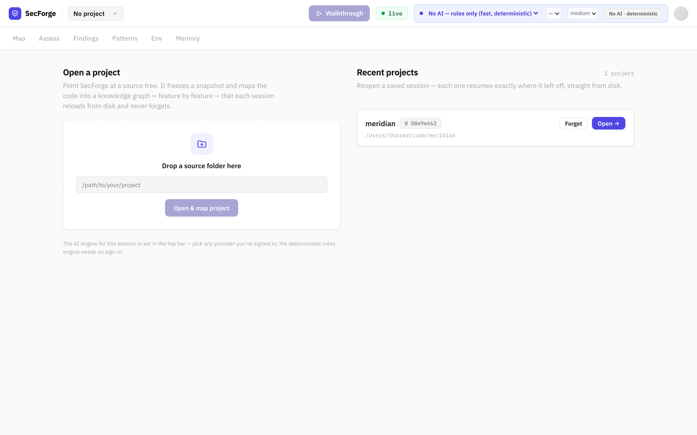</p>

## How it works

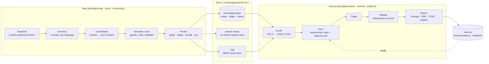

### 1. Snapshot

The source tree is copied into a content-addressed snapshot under the project store. Every later step, including the AI Lead, reads only this frozen copy. Mapping the same tree twice yields the same snapshot id, so a previous AI ontology is reused instead of paid for again.

### 2. Inventory

A deterministic, multi-language extractor walks the snapshot and emits inventory rows in eleven kinds: routes and endpoints, REST, GraphQL SDL, workers and jobs, services, response shaping, downloads and uploads, search and aggregation, tokens and actors, processes and IPC, data stores and integrations. Framework plugins (Rails, Django REST Framework) sit on top of a universal extractor, so Go, Java, PHP, Node, Python and Ruby trees all produce rows.

### 3. Consolidate

Rows are clustered by module and then by noun, so a rules-only map of a 300-row project yields twenty named clusters rather than three lumps. Clusters that cannot be confirmed as a business feature stay visible as *unconfirmed clusters* instead of being hidden.

### 4. Semantic Lead

With an agentic engine selected, a mapping Lead explores the frozen snapshot itself using read-only tools (Read, Glob, Grep), bounded by a turn cap derived from the chosen effort, and returns a JSON-schema-validated ontology: business features, actors, roles and permissions, each with citations. The evidence validator re-checks every citation against the snapshot. Entities that fail are rejected and counted; they never enter the graph.

### 5. Persist

The graph (nodes, edges, inline `file:line` claims) and a reconciliation ledger that terminates every inventory row (mapped to feature, shared infrastructure, or an honest gap) are written to SQLite. Two portable projections are written next to the snapshot:

- `phase1-maps/`: a README, an AI context file, one 13-section markdown document per feature (entry-point ledger, authorization map, actor map, data exposure, background jobs, same-functionality siblings, assess handoff, coverage), role matrices, consolidated cross-feature matrices, a completion gate, and the graph as JSONL.
- `rag/`: one chunk per feature, entry point, job, service, data store, role, permission, actor and auth check, each carrying its feature and its `file:line` pointers. This is what lets a later "test X" land in the right place.

### 6. Assess

A run is a resumable session. The Question-framer scopes it (one feature, a picked set, or all), the hunters run the deterministic rule engine over the graph, an optional LLM-assist step may add candidates grounded in that feature's own citations, the triager and validator independently re-prove every candidate, and the reporter freezes survivors into findings with CWE, CVSS, remediation and a source snippet. Coverage is tracked as a feature × pattern-family matrix where every cell carries a verdict.

## The workbench, tab by tab

### Map → Graph

The system graph is a layered tree: project, domains, features, unconfirmed clusters. Each feature box states its entry-point count and how many of those have no authorization or no authentication. Hovering highlights neighbours; clicking opens the inspector.

<p align="center">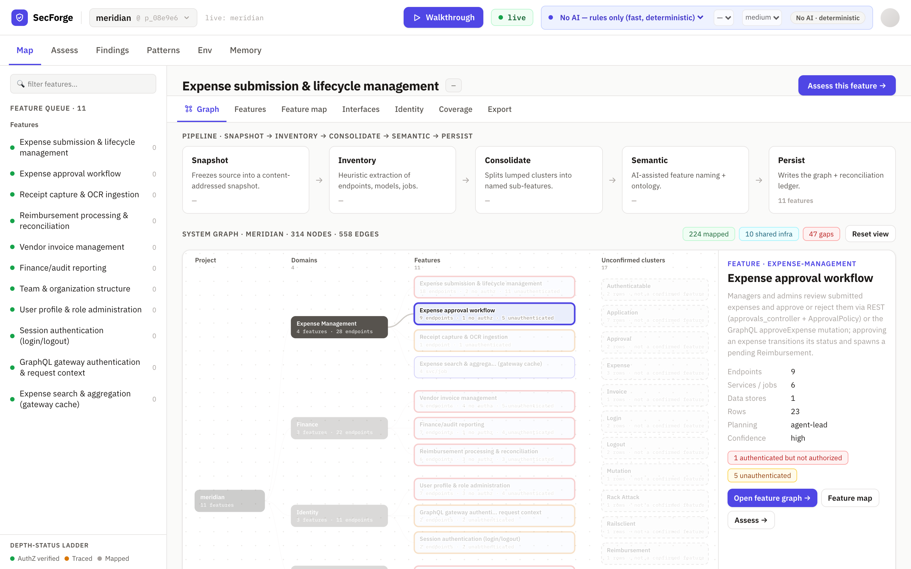</p>

Opening a feature switches to its layered flow: actors and roles → auth checks → endpoints → services and jobs → data stores. Edge colours distinguish authentication, authorization, role requirements and plain use; red outlines mark entry points with a gap.

<p align="center">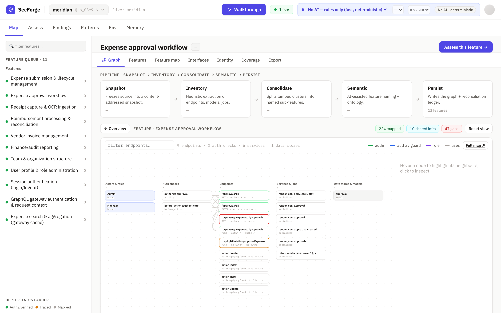</p>

### Map → Features

Every feature the codebase exposes, with its domain, entry points, roles and actors, authorization gaps, Lead confidence and primary source file.

<p align="center">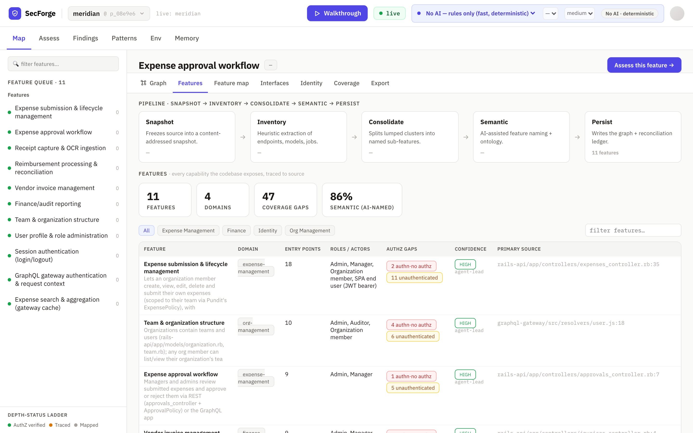</p>

### Map → Feature map

Pick one feature and see only that feature: purpose, who reaches it, tiles by interface kind, then an **access matrix** with one row per entry point and one column per role plus Anonymous. ✓ allowed, ✗ denied, ◐ object-level policy decides. The amber Anonymous cell means reachable without a login. Below it, the feature's permissions and the full 13-section document.

<p align="center">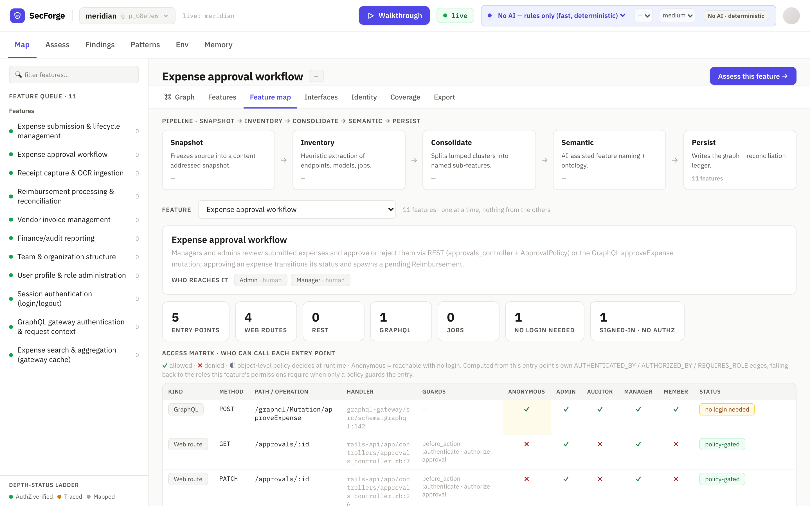</p>
<p align="center">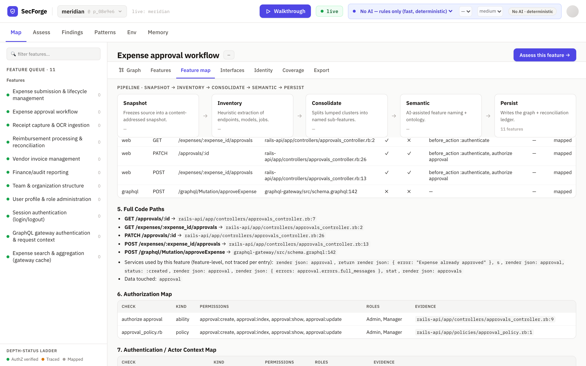</p>

### Map → Interfaces, Identity, Coverage, Export

- **Interfaces**: every web route, REST endpoint, GraphQL operation and job across the project, with handler, authn/authz, guards and owning feature.
- **Identity**: actors, the role ladder, and the role → ability matrix, each row cited to the production source that establishes it.
- **Coverage**: technical and semantic coverage, the reconciliation ledger by inventory kind, and the completion gate. Coverage means the map is complete, not that every vulnerability was found.
- **Export**: the `phase1-maps/` bundle written for this snapshot, served read-only.

<p align="center">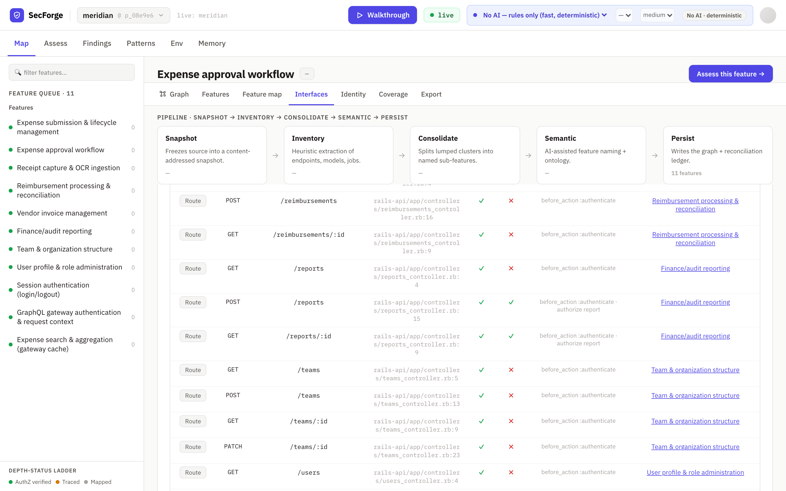 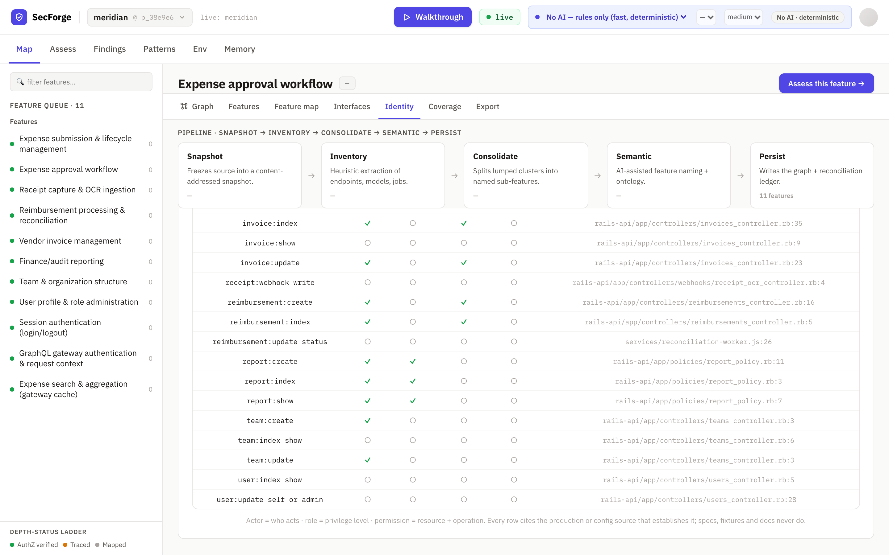</p>
<p align="center">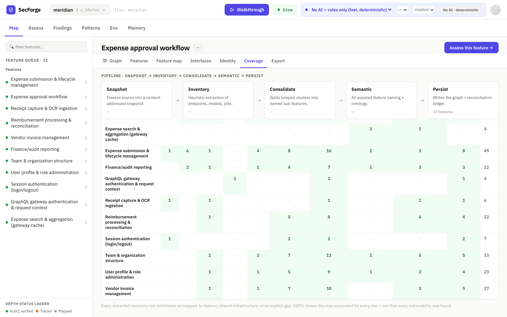 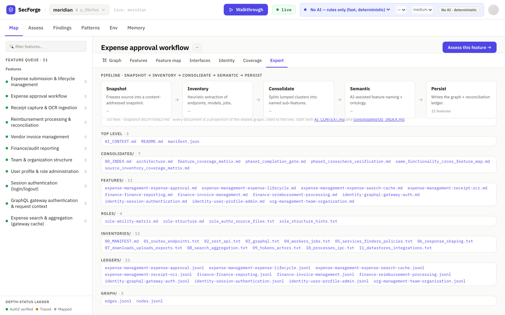</p>

### Assess → "Test X"

Choose a scope, choose a method (pattern families, a free-text prompt, or a full sweep), and run. In prompt mode the retrieval store answers *where the map says X lives* while you type: ranked features, matching entry points, roles, gap chips and the exact file lines. The run is then narrowed to those features.

<p align="center">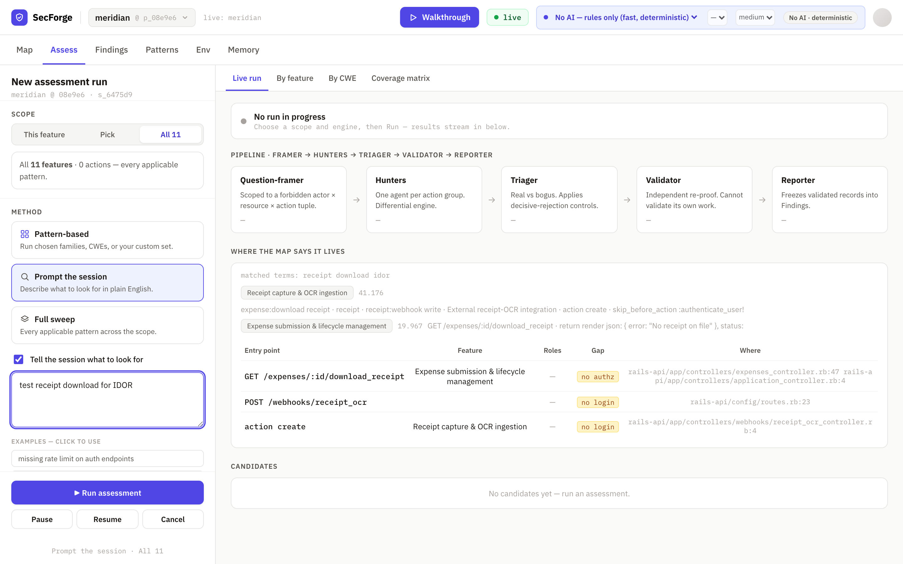</p>

After the run, the live pipeline shows what each stage did, **Where this run looked** records the features actually assessed, and candidates are listed with severity, family and CWE.

<p align="center">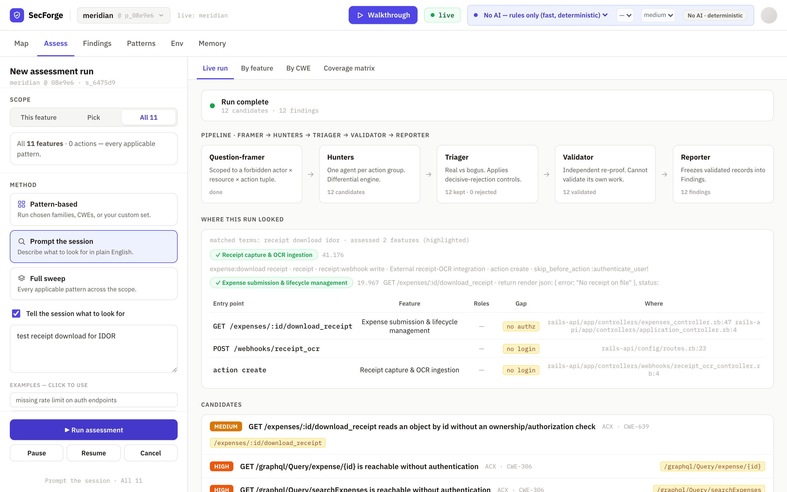</p>

The coverage matrix is the denominator: every feature × family cell carries a verdict, so nothing is silently skipped.

<p align="center">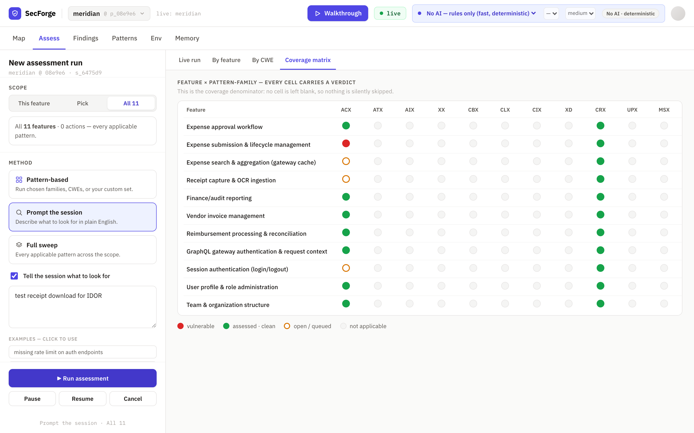</p>

### Findings

Each finding carries the rule that proved it, the CWE, a CVSS vector and score, the route, the owning feature, a snippet from the frozen snapshot with the offending line marked, and a remediation. Mark false positives, confirm, export a single finding or the whole assessment as HackerOne-style markdown, plain markdown or JSON, or validate live against an authorised target.

<p align="center">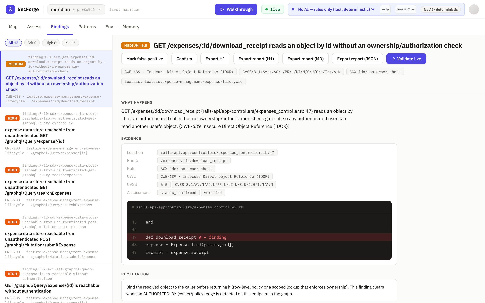</p>

### Patterns, Memory, Env

- **Patterns**: 24 families, 281 canonical cards and 42 CWE mappings vendored into the repo, plus import of your own pattern folder.
- **Memory**: accept and reject verdicts are mined into learned patterns, consolidated after each scan, and recalled before the next one, across projects.
- **Env**: register a running target to validate findings dynamically. Static-only until you tick *I am authorised*; credentials are encrypted at rest.

<p align="center">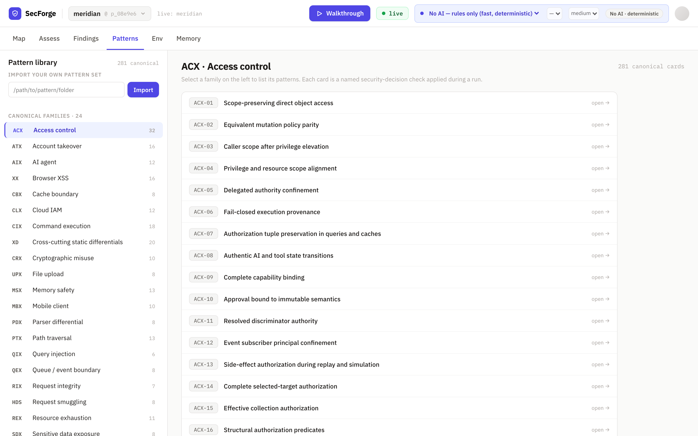 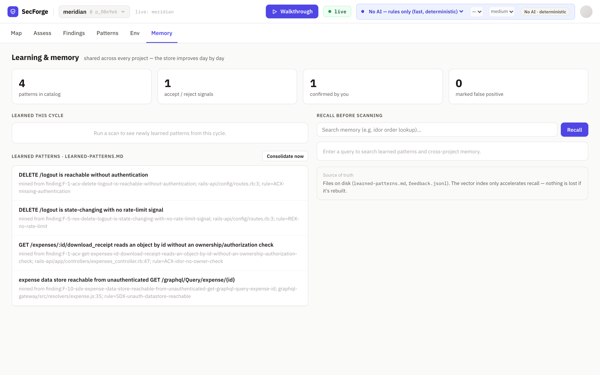</p>
<p align="center">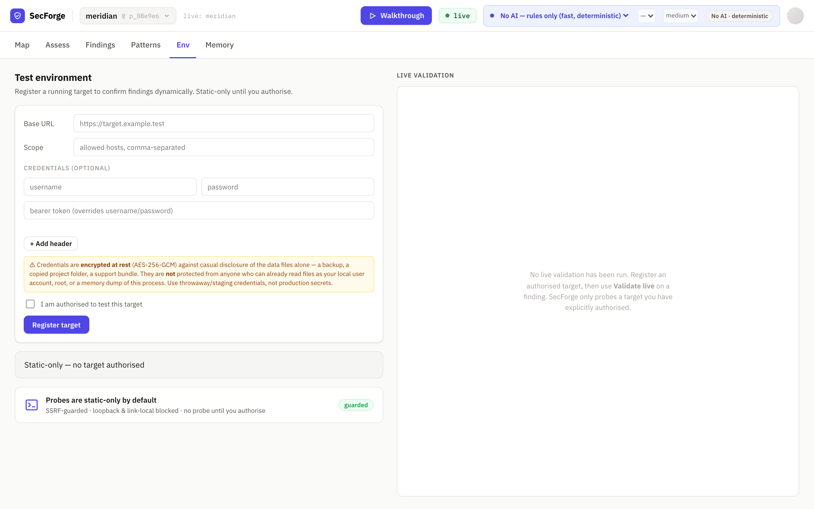</p>

## AI engines

The engine is chosen in the top bar per session. Everything works with **No AI**; AI adds the semantic Lead during mapping and a grounded assist step during assessment.

| Engine | How it is reached | Mapping | Assess |
|---|---|---|---|
| No AI (rules) | in-process | module + noun clustering | deterministic rules |
| Claude Code | `claude -p` headless CLI (run `claude` once to sign in) | agentic Lead over the frozen snapshot | grounded LLM assist |
| Codex | `codex exec` CLI (`codex login`) | agentic Lead | grounded LLM assist |
| Gemini | detected (`gemini` CLI or `GEMINI_API_KEY`) | not wired yet, falls back to rules | rules only |
| Ollama | HTTP to `OLLAMA_HOST` | one-shot | one-shot assist |
| OpenAI API | HTTP, `OPENAI_API_KEY` | one-shot | one-shot assist |
| Anthropic API | HTTP, `ANTHROPIC_API_KEY` | one-shot | one-shot assist |

Effort (low / medium / high / max) bounds the Lead's turn budget, the amount of context fed to each per-feature prompt, and how many LLM-nominated candidates a run may add. Any LLM-nominated candidate must still be independently re-proved by a deterministic rule before it becomes a finding, and must cite a `file:line` from that feature's own citation pool or it is dropped.

Keys are read from the environment only. SecForge never writes an API key to disk.

## Data layout

```
~/.secforge/projects/<project-id>/          # SECFORGE_DATA relocates the whole root
  project.json                              # name, sourceRoot
  events.log                                # append-only event stream
  graph/current.json                        # pointer to the current snapshot
  graph/index.sqlite                        # nodes · edges · claims · reconciliation
  snapshots/<sha256>/
    source/                                 # the frozen tree every citation points into
    source-manifest.jsonl                   # per-file hashes (snippet staleness checks)
    inventory.jsonl                         # the deterministic inventory rows
    lead.json                               # agentic Lead provenance (engine, turns, accepted, rejected)
    phase1-maps/                            # portable 13-section feature bundle
    rag/chunks.jsonl · rag/index.json       # the "where does X live" store
  findings/*.json                           # one file per finding
  assess/runs/*.json                        # session + run records
  memory/learned-patterns.md · feedback.jsonl
  env/target.json                           # authorised test target (headers encrypted)
```

## HTTP API

The server binds `127.0.0.1:4770` (`PORT` to change) and serves the UI from `apps/server/public`. The JSON API the UI uses is yours to script:

| Route | Purpose |
|---|---|
| `GET /api/health` | liveness |
| `GET /api/projects` · `POST /api/projects {sourceRoot}` · `DELETE /api/projects/:id` | open, list, forget |
| `POST /api/projects/:id/map {engine, model, effort}` | map (or re-map) the source tree |
| `GET /api/projects/:id/graph` · `/reconciliation` · `/inventory` | the knowledge graph, ledger and raw inventory |
| `GET /api/projects/:id/features/:fid/context` | a feature's cited dossier (the feed-forward bundle) |
| `GET /api/projects/:id/features/:fid/map` | the feature's 13-section document (markdown) |
| `GET /api/projects/:id/maps` · `/maps/<path>` | the `phase1-maps/` bundle, read-only, traversal-guarded |
| `GET /api/projects/:id/locate?q=<what to test>` | where X lives: ranked features, entry points, files |
| `GET /api/projects/:id/answer?q=` | model-free, fully cited answer over the graph |
| `POST /api/sessions/:id/scan?project= {scope, engine, model, effort}` | run an assessment |
| `GET /api/sessions/:id/stream` | server-sent events for the live pipeline |
| `POST /api/sessions/:id/{pause,resume,cancel}?project=` | session lifecycle |
| `GET /api/projects/:id/findings` · `/coverage` · `/report?format=h1\|md\|json` | results |
| `POST /api/projects/:id/feedback` · `POST /api/findings/:id/validate` | verdicts and live validation |
| `GET /api/patterns` · `/patterns/cards` · `POST /api/patterns/import` | the pattern library |
| `GET`/`POST /api/projects/:id/memory` · `/memory/consolidate` · `/env` | memory and test target |

## Repository layout

```
apps/
  cli/            secforge open | ls | status | resume | pause | cancel | doctor | serve
  server/         loopback UI server + JSON/SSE API; public/ holds the hand-rolled UI
packages/
  schemas         graph vocabulary, envelopes, ids, session states
  store           durable project store (files + events.log + sqlite graph)
  session         session manager + lifecycle FSM (a scan is a session)
  inventories     deterministic multi-language extraction (plugins + universal + GraphQL SDL)
  recon           clustering, graph build, evidence validator, agentic Lead
  map             snapshot → graph, incremental remap, phase1-maps bundle, rag store
  retrieval       cited feature dossiers, feed-forward bundles, BM25 locate()
  assess          hunt → triage → validate → report, coverage matrix, exporters
  patterns        canonical families, cards, CWE mapping, custom import
  adapters        engine backends (rules, claude-code, codex, gemini, ollama, openai, anthropic)
  orchestration   in-session map/scan orchestrators + live event bus
  orchestrator    bounded-concurrency fan-out scheduler
  agents          framer / hunter / triager / validator / reporter roles
  memory          learned patterns, feedback, cross-project recall
  env             guarded dynamic validation, secrets-at-rest
examples/meridian deliberately flawed sample app (Rails API + GraphQL gateway + worker)
docs/             design documents per phase, wiring map, screenshots
```

## Configuration

| Variable | Effect |
|---|---|
| `PORT` | UI/API port (default 4770) |
| `SECFORGE_DATA` | data root (default `~/.secforge/projects`) |
| `SECFORGE_ALLOW_ROOT` | confine which source trees may be opened |
| `SECFORGE_DEFAULT_ENGINE` | engine preselected in the top bar |
| `SECFORGE_LEAD_TIMEOUT_MS` · `SECFORGE_LLM_TIMEOUT_MS` | upper bounds for the Lead and per-feature LLM calls |
| `SECFORGE_ENV_KEY` | base64 32-byte key for credentials at rest (else a machine-local key is generated) |
| `SECFORGE_ALLOW_INTERNAL` | permit live probes against loopback and link-local hosts |
| `OPENAI_API_KEY` · `OPENAI_BASE_URL` · `ANTHROPIC_API_KEY` · `GEMINI_API_KEY` · `OLLAMA_HOST` | HTTP engines |

## Security model

SecForge is a **local, single-user, loopback-only** workbench. The server binds `127.0.0.1` and checks `Host` and `Origin` against DNS rebinding. The operator is trusted to point it at their own source trees and test targets.

- Live validation is static-only by default. A network probe runs only after a target is registered with *authorised: true* and the call passes `dryRun:false`. Cloud-metadata and loopback hosts are blocked unless `SECFORGE_ALLOW_INTERNAL=1`, redirects are not followed, requests time out, and only a single read-only GET is ever sent.
- Target credentials are encrypted at rest with AES-256-GCM. This protects the data files alone (a backup, a synced folder); it does not protect against anyone who can already read files as your user. Use throwaway credentials.
- The data store lives outside the source tree. No source, finding or key is ever written back into the repository being assessed.
- The agentic Lead runs with read-only tools against the frozen snapshot, never the live tree, and with `--setting-sources ''` so no project-level instructions can steer it.

## Testing

```bash
npm test                                     # whole workspace, 401 tests, no network
node --test packages/retrieval/test/*.test.js   # one package
```

Tests use fake adapters for LLM paths and temporary data roots; nothing touches `~/.secforge`.

## Status and roadmap

Working v1, end-to-end. Known limits and next steps:

- The Lead's feature split is nondeterministic run-to-run (10 vs 11 features on the sample). Rows it leaves unclaimed are surfaced as gaps, not hidden; a second Lead pass over those rows is the obvious next step.
- Deterministic detectors cover access control, authentication, data exposure, CSRF, rate limiting and weak crypto. Query injection and SSRF have no dataflow tracer yet and are deliberately not promoted from LLM output.
- `codex` is wired but less exercised than `claude-code`; `gemini` is detected but not yet driven.

Design documents for each phase live in `docs/`: [plan](docs/SECFORGE-PLAN.md), [backend architecture](docs/BACKEND-ARCHITECTURE.md), [wiring map](docs/WIRING.md), [roles and inventory](docs/PHASE1-ROLES-INVENTORY-DESIGN.md), [assess depth](docs/PHASE2-ASSESS-DEPTH-DESIGN.md), [learning](docs/PHASE3-LEARNING-DESIGN.md), [env provider](docs/PHASE4-ENV-PROVIDER-DESIGN.md), [polish](docs/PHASE5-POLISH-DESIGN.md), [sqlite graph](docs/SQLITE-GRAPH-DESIGN.md).

## License

[MIT](LICENSE)
